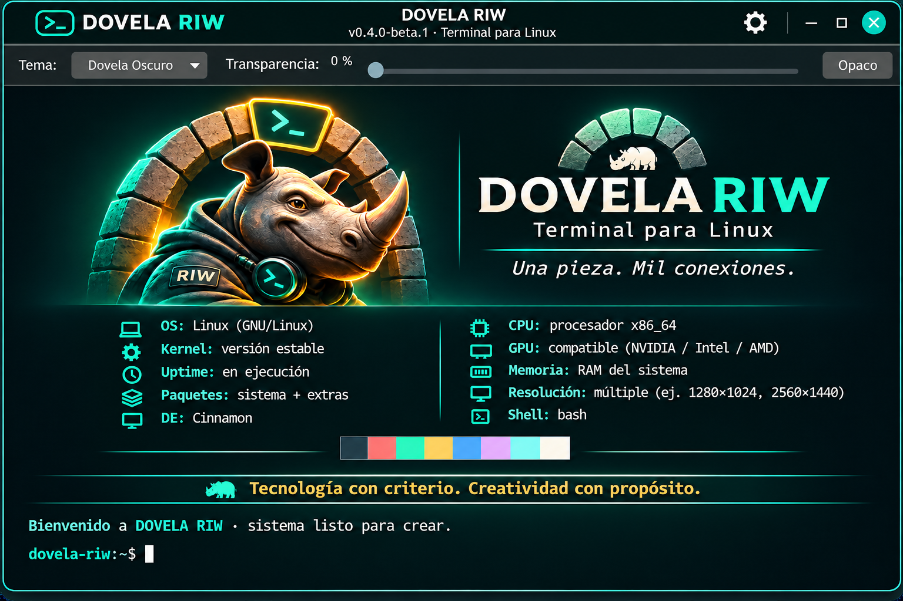

# DOVELA RIW

*Imagen ilustrativa con datos de sistema genéricos.*

Terminal gráfica experimental para Linux, desarrollada por
Rhynus Interactive Works (RIW).

Dovela utiliza Python 3, GTK 3 y VTE 2.91.

## Características

- Terminal integrada con VTE.
- Temas visuales configurables.
- Control de transparencia.
- Identidad visual DOVELA RIW.
- Tipografía Ubuntu Mono.
- Controles de configuración.

## Estado

Versión candidata: v0.4.0-beta.1.

Probada manualmente en Linux Mint.
Otras distribuciones: pendientes de validación.

## Instalación

Consultar [INSTALL.md](INSTALL.md).

## Licencia

El código fuente se distribuye bajo GPL-3.0-or-later.
Consultar [LICENSE](LICENSE).

La identidad gráfica RIW tiene condiciones separadas.
Consultar [assets/LICENSE.md](assets/LICENSE.md).

## Autoría

Rhynus Interactive Works (RIW).
